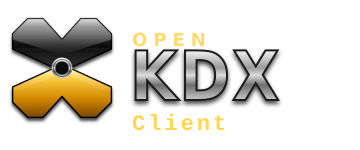
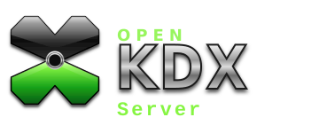
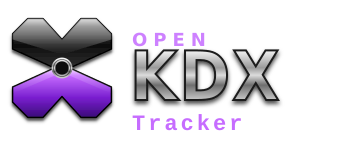

<p align="center">
  
  
  
</p>

# OpenKDX

A modern, memory-safe reimplementation of Haxial KDX — the early-2000s encrypted BBS-style chat, news, and file-sharing system — in Rust, wire-compatible with the original programs so old and new can share a network.

**Status:** Phase 3b complete — one implementation, two repositories. The protocol, codec, client, dissector and on-disk-format code now lives in the reference implementation's crates, developed in the fork [spitfire915/kdx](https://github.com/spitfire915/kdx) and sent upstream to [scottanderson/kdx](https://github.com/scottanderson/kdx) by pull request, with our fifteen captures, our protocol findings, the client features and `kdx-legacy` (the files the original programs keep, read and written byte for byte). OpenKDX pins those crates by revision and keeps what is its own: the `openkdx` command line (chat, messages, news, files, accounts and administration against an original server), the challenge-table tool, the lab that runs the original programs, and the captures. On every push to either repository the lab runs the fork's client against KDX Server 1.620 and Tracker 1.110 and restarts the server on files `kdx-legacy` rewrote. Next: the server (Phase 4). See the [phases](docs/superpowers/specs/2026-11-08-openkdx-design.md#8-phases).

| Program | Binary | What it is |
|---|---|---|
| Client | `openkdx` | A desktop client with a faithful "Classic" mode (Haxial's own window system, one OS window per function, the KDX Dock, original `.hap` appearance files) and a "Modern" mode that docks the same windows as tabs in one unified window. |
| Server | `openkdxd` | A headless daemon that serves an existing KDX Server directory (`Accounts.dat`, `KDXServer.stg`, `Bases/`, news) unchanged, administered from any KDX client. |
| Tracker | `kdx-tracker` (in the fork) | A tracker that original and OpenKDX servers register with and original and OpenKDX clients browse. |

## Compatibility

OpenKDX targets the last Haxial releases: **KDX Server 1.620**, **KDX Client 1.600**, and **KDX Tracker 1.110**. Every claim of compatibility is verified by differential testing against those programs running in a sandboxed lab.

The protocol reference OpenKDX builds on is [scottanderson/kdx](https://github.com/scottanderson/kdx/tree/main/docs/protocol). Where our captures or analysis differ, the deltas are documented in `docs/protocol/`.

## What is here

| Crate | Where | What it does |
|---|---|---|
| `kdx-proto` | [in the fork](https://github.com/spitfire915/kdx/tree/main/crates/kdx-proto) | The wire format, with no I/O: handshake, session encryption and framing, UDP tracker registration, a typed struct for every message. |
| `kdx-codec` | in the fork | `tokio_util::codec` framing for the handshake and the session, with streaming file-transfer data. |
| `kdx-client` | [in the fork](https://github.com/spitfire915/kdx/tree/main/crates/kdx-client) | The async client library: login, chat, PM, news, files and transfers with resume, accounts, administration, tracker browse; a scripted mock server for tests. |
| `kdx-dissect` | in the fork | Decodes KDX connections in pcap/pcapng captures; `--audit` proves each payload re-encodes byte-exact; `--inventory` lists the messages. |
| `kdx-legacy` | [in the fork](https://github.com/spitfire915/kdx/tree/main/crates/kdx-legacy) | The originals' on-disk formats, read and written byte for byte, with one-time `.orig` backups, and `.hap` themes; sound lists deferred. |
| [`openkdx-table`](crates/openkdx-table) | here | Obtains the challenge tables at runtime ([how](docs/setup/challenge-tables.md)); they are never shipped. |
| [`openkdx-cli`](crates/openkdx-cli) | here | `openkdx`: a thin command-line client over `kdx-client`; drives the lab's capture scenarios. |
| `openkdx-ui`, `openkdx-app`, `openkdxd` | here, planned | Phases 4–10; the server library and tracker program are built in the fork as `kdx-server` and `kdx-tracker`. |

The [lab](lab/README.md) runs the original programs in a sandbox and records the [captures](captures/README.md) that every protocol claim is checked against. Try the fork's dissector on one (the fork checked out beside this repository):

```sh
cargo run --manifest-path ../kdx/Cargo.toml -p kdx-dissect -- captures/chat-basic.pcapng --password openkdx-lab --audit
```

Or talk to a server (the challenge table must be [available](docs/setup/challenge-tables.md)):

```sh
cargo run -p openkdx-cli -- -s kdx.example.net -l guest login
cargo run -p openkdx-cli -- -s kdx.example.net chat watch "Public Chat" --for 60
cargo run -p openkdx-cli -- -s kdx.example.net files ls -L
```

Or look inside an original server's files:

```sh
cargo run --manifest-path ../kdx/Cargo.toml -p kdx-legacy --example legacytool -- dump /path/to/Accounts.dat
```

## Documentation

- [Design](docs/superpowers/specs/2026-11-08-openkdx-design.md) — intent, goals, constraints, architecture, phases.
- [Protocol notes](docs/protocol/README.md) — what we confirmed, and where our captures differ from the reference spec.
- [Captures](captures/README.md) — the lab scenarios and what each one shows.
- [On-disk formats](docs/formats/README.md) — a pointer to the fork's pages on every file the originals keep.
- [Contributing](CONTRIBUTING.md) — checks, commit style, and the legal rules.
- [NOTICE](NOTICE.md) — what this project does and does not contain.

## Licence

Licensed under either of [Apache License, Version 2.0](LICENSE-APACHE) or [MIT license](LICENSE-MIT), at your option.
